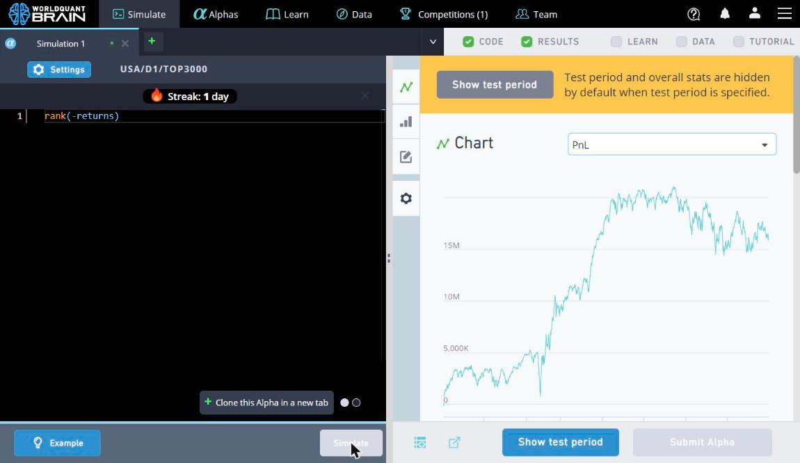
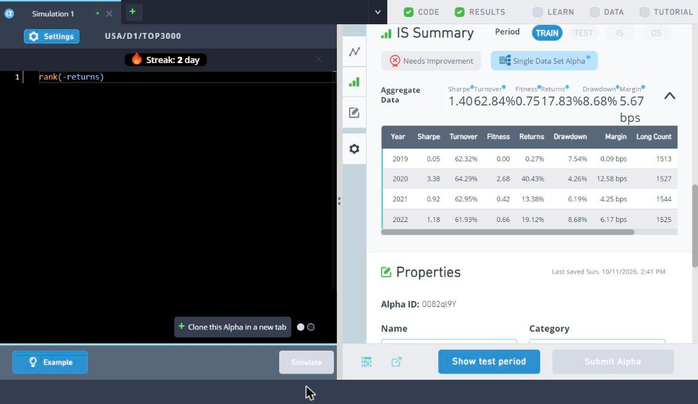
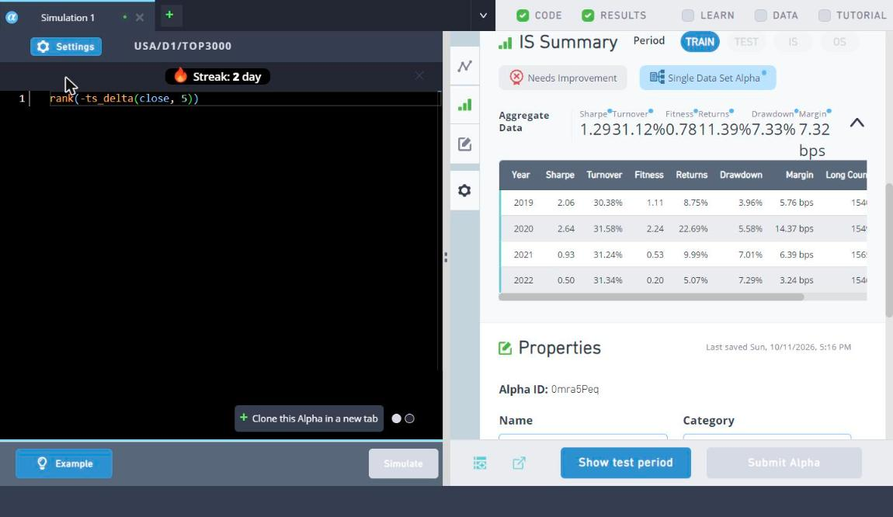
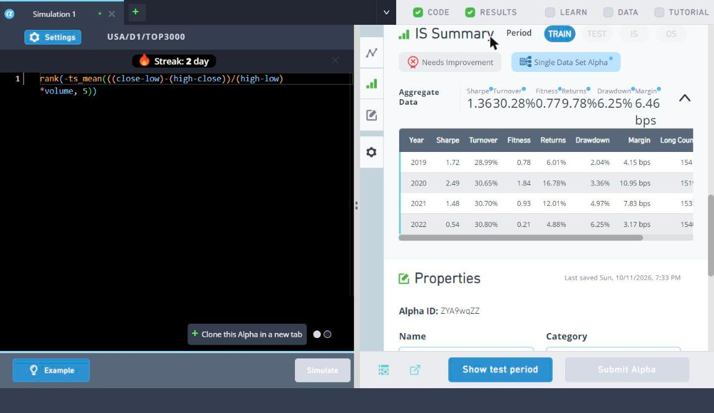
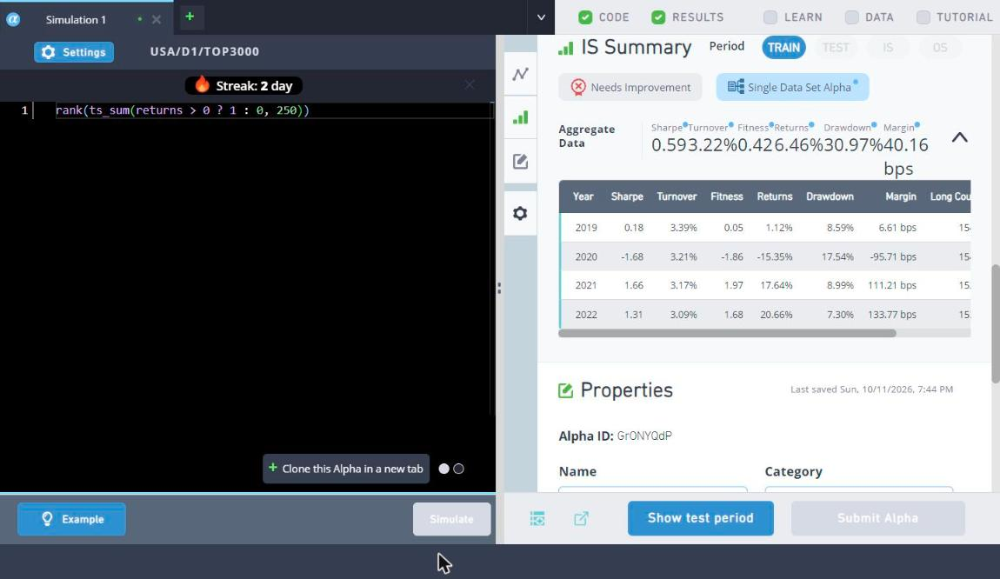
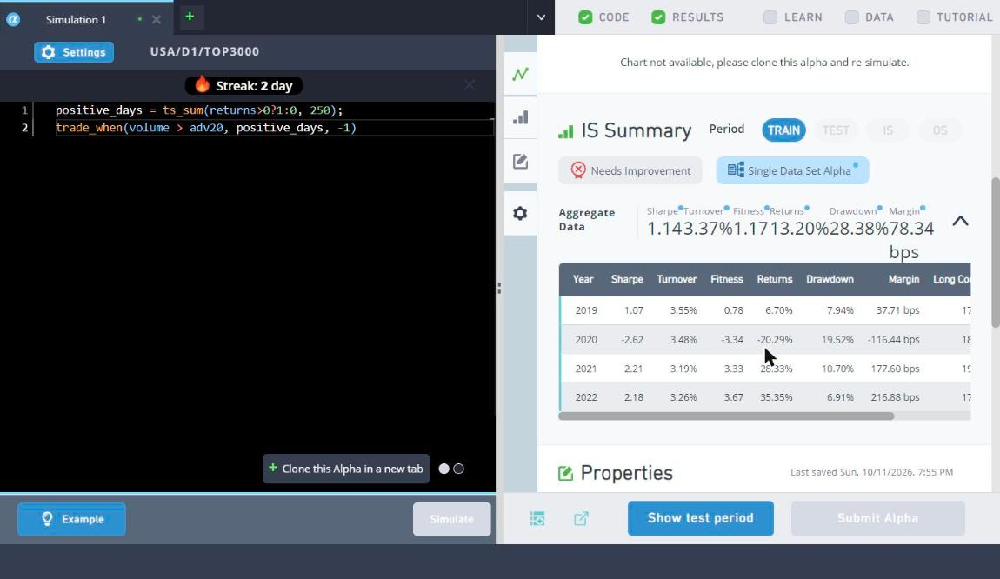

# Week 1: From Reversion to a First Submission

- Period: through 2026-10-11
- Scope: BRAIN Tutorial Chapters 1–2
- Simulations: ~30, 1 submitted
- Common settings: USA · D1 · TOP3000 · Truncation 0.08 (noted where different)

## Summary

I started from "stocks that rose yesterday fall today" (short-term reversion) and changed one setting or data field at a time.
Price–volume alphas alone could not pass the submission checks, so I **blended in a fundamental signal** and submitted my first alpha.

## Roadmap

```
rank(-returns)  --settings-->  Decay 8 + Subindustry        Sharpe 1.40
      |
      +-- change data field -->  close / vwap               Sharpe 1.62
      +-- longer horizon ----->  5-day change (ts_delta)    Turnover halved
      +-- build an indicator ->  CLV x volume               Sharpe 1.73
      |
Momentum (1-year up-days) -->  trade_when on volume spikes  Sharpe 1.14
      |
      +-- failed submission (Sharpe 1.1-1.3) --> reversal + fundamentals  Sharpe 2.46  SUBMITTED
```

---

## 1. How settings change the result: `rank(-returns)`

**Idea:** sell yesterday's biggest winners and buy the biggest losers (short-term reversion).
I kept the expression fixed and changed one setting at a time.

| Change | Sharpe | Turnover | Fitness | Drawdown | Interpretation |
|---|---|---|---|---|---|
| Neutralization None | – | ~22% | – | – | Zero shorts. Rank values are all positive, so it is long-only — a bet on the market. Lost money in the 2022 bear market |
| Flip the sign: `rank(returns)` | -1.39 | 86% | -0.76 | 105% | At a 1-day horizon, reversion works, not momentum |
| Market, Decay 0 | 1.02 | 130% | 0.35 | 12.5% | The whole book turns over daily — hard to trade in practice |
| Market, Decay 8 | 1.25 | 65% | 0.77 | 15.9% | Turnover halved, and Sharpe rose because noise was smoothed out |
| **Subindustry**, Decay 8 | **1.40** | 63% | 0.75 | **8.7%** | Comparing stocks only within their subindustry removes industry risk; drawdown halved |
| Truncation 0.08 → 0.01 | 1.40 | 63% | 0.75 | 8.7% | No change. A rank alpha spreads weight evenly over 3,000 stocks, so no position hits the cap |

<details>
<summary>Screenshots</summary>

Neutralization None (zero shorts)


Decay 0 → Decay 8


Subindustry

</details>

**Takeaway:** neutralization subtracts the mean to create a long/short book. Decay is the easiest way to cut turnover.

---

## 2. Same idea, different data

Settings fixed at Subindustry · Decay 8; only the expression changes.

### `rank(-close/vwap)` — Sharpe 1.62

**Idea:** if the close is above the day's volume-weighted average price (VWAP), the stock is overheated and should revert the next day.

| Sharpe | Turnover | Fitness | Returns | Drawdown | Margin |
|---|---|---|---|---|---|
| 1.62 | 61.49% | 0.76 | 13.37% | 7.78% | 4.35 bps |

"Close vs. the day's average price" turned out to be a less noisy signal than the daily return. Sharpe was positive in every year.


### `rank(-ts_delta(close, 5))` — 5-day reversal

**Idea:** stretching the horizon from 1 day to 5 days should make positions change less often and cut turnover.

| Sharpe | Turnover | Fitness | Margin |
|---|---|---|---|
| 1.29 | **31.12%** | 0.78 | 7.32 bps |

Turnover halved, but Sharpe fell too. A longer horizon is cheaper to trade but carries a weaker signal.



---

## 3. Building an indicator: CLV × volume — Sharpe 1.73

**Idea:** CLV (Close Location Value) measures where the close sits within the day's range:
+1 near the high, −1 near the low. Multiplying by volume puts more weight on moves backed by heavy trading, and flipping the sign turns it into a reversion bet.

```
CLV   = ((close - low) - (high - close)) / (high - low)
alpha = rank(-CLV * volume)
```

| Version | Sharpe | Turnover | Fitness | Drawdown |
|---|---|---|---|---|
| Wrapped in `ts_mean(·, 5)` | 1.36 ✗ | 30.28% | 0.77 | 6.25% |
| `ts_mean` removed | **1.73** ✓ | 62.43% | **0.82** | **5.35%** |

**Mistake and lesson:** out of habit I reused the 5-day average that had lowered turnover earlier, and missed the 1.4 Sharpe target.
CLV captures *one day's* sentiment; averaging over five days blurs exactly that.
Before reusing a trick, ask **what horizon the signal lives on**.

<details>
<summary>Screenshots</summary>

With ts_mean (1.36)


Without ts_mean (1.73)

</details>

---

## 4. Momentum: one-year up-day count

**Idea:** my first momentum alpha. Using the raw one-year return mixes in short-term reversion, so I only count *how many days* the stock went up over the past year.

```
positive_days = ts_sum(returns > 0 ? 1 : 0, 250)
```

| Version | Sharpe | Turnover | Fitness | Returns | Margin |
|---|---|---|---|---|---|
| `rank(positive_days)` | 0.59 | **3.22%** | 0.42 | 6.46% | 40 bps |
| `trade_when(volume > adv20, positive_days, -1)` | **1.14** | 3.37% | **1.17** | 13.20% | 78 bps |

- The signal moves slowly, so turnover is around 3% — very robust to trading costs.
- With `trade_when`, the signal only updates **on days when volume is above its 20-day average**, which roughly doubled Sharpe.
- But 2020 (the COVID crash and rebound) broke it badly, with a yearly Sharpe of −2.6. Momentum depends on the market regime.

**1-day momentum failed (Sharpe −1.39); 1-year momentum worked.** Momentum shows up at medium horizons (3–12 months).

<details>
<summary>Screenshots</summary>



</details>

---

## 5. Passing the submission checks: reversal + fundamentals — Sharpe 2.46 ✓

### Where I got stuck

I tuned the momentum + `trade_when` alpha about eight times: Decay (0 → 8 → 20), neutralization (Subindustry → Industry → Market) and the entry condition.
The on-screen Train Sharpe reached 1.28, but **the submission check uses the full IS period including the test window**, where Sharpe was 1.11 and sub-universe Sharpe 0.37 — a fail.

### What fixed it

A search turned up this advice: "pure price–volume alphas rarely pass; blend in a slow fundamental signal and use Decay 10–30."

| Item | Detail |
|---|---|
| Idea | Blend a fast signal (intraday price reversal) and a slow one (6-month rank of operating income to equity) 50:50 |
| Operators | `rank`, `ts_rank` |
| Data fields | `close`, `open`, `operating_income`, `equity` |
| Settings | Industry · Decay 10 · Truncation 0.08 · NaN handling On · Test period 0 |
| Result | **Sharpe 2.46 · Fitness 1.91 · Turnover 18.96%** · Returns 11.40% · Drawdown 4.07% · Margin 12.03 bps |
| Checks | 7 passed, submitted (ACTIVE) |

**Why it worked:** the two signals have different characters and cover each other's weak years. The 2020 loss that hurt the momentum alpha disappeared, and yearly Sharpe stayed above 1.8 throughout. The slow fundamental leg also brought turnover down to 19%.

> Since this alpha is submitted, I don't publish the exact expression or a screenshot showing it.

---

## What I learned this week

1. **Neutralization** creates the long/short book and strips out industry risk. Switching to Subindustry halved drawdown.
2. **Decay** is the easiest way to cut turnover, and it damages the signal less than wrapping the expression in `ts_mean`.
3. **On-screen Train numbers and the submission check use different periods.** Setting Test period to 0 shows the real criterion.
4. **Search early when stuck.** Ten rounds of tuning didn't help; one search did.

## Next week

- Build alphas from fundamental and analyst data fields
- Blend signals of different character to submit more alphas with low self-correlation

## All experiments

<details>
<summary>Show all 23 runs</summary>

| # | Expression | Neutralization | Decay | Sharpe | Turnover | Fitness |
|---|---|---|---|---|---|---|
| 1 | `rank(-returns)` | None | 4 | – | ~22% | – |
| 2 | `rank(returns)` | Market | 4 | -1.39 | 86.05% | -0.76 |
| 3 | `rank(-returns)` | Market | 0 | 1.02 | 130.15% | 0.35 |
| 4 | `rank(-returns)` | Market | 8 | 1.25 | 64.91% | 0.77 |
| 5 | `rank(-returns)` | Subindustry | 8 | 1.40 | 62.84% | 0.75 |
| 6 | `rank(-returns)`, Truncation 0.01 | Subindustry | 8 | 1.40 | 62.84% | 0.75 |
| 7 | `rank(-close/vwap)` | Subindustry | 8 | 1.62 | 61.49% | 0.76 |
| 8 | `rank(-ts_delta(close, 5))` | Subindustry | 8 | 1.29 | 31.12% | 0.78 |
| 9 | `rank(ts_mean(vwap/close, 5))` | Subindustry | 8 | 1.01 | 29.48% | 0.52 |
| 10 | `rank(-ts_mean(CLV*volume, 5))` | Subindustry | 8 | 1.36 | 30.28% | 0.77 |
| 11 | `rank(-CLV*volume)` | Subindustry | 8 | 1.73 | 62.43% | 0.82 |
| 12 | `rank(ts_sum(returns>0 ? 1 : 0, 250))` | Subindustry | 8 | 0.59 | 3.22% | 0.42 |
| 13 | #12 + `trade_when(volume > adv20, ·, -1)` | Subindustry | 8 | 1.14 | 3.37% | 1.17 |
| 14 | #13 | Industry | 8 | 1.13 | 3.24% | 1.24 |
| 15 | #13 | Industry | 0 | 1.08 | 5.11% | 1.16 |
| 16 | #13 | Industry | 20 | 1.16 | 2.70% | 1.28 |
| 17 | #13 | Market | 20 | 1.19 | 2.22% | 1.52 |
| 18 | #13, signal delayed 10 days | Market | 20 | 1.21 | 2.18% | 1.55 |
| 19 | #18, entry = dollar volume above 60-day mean | Market | 20 | 1.25 | 2.16% | 1.63 |
| 20 | #19, 120-day window | Market | 20 | 1.28 | 2.16% | 1.68 |
| 21 | CLV×volume + 1-year up-days blend (Test period 0) | Subindustry | 8 | 1.05 | 23.45% | 0.69 |
| 22 | `trade_when(volume > adv20, rank(CLV*volume), -1)` (Test period 0) | Subindustry | 8 | 1.17 | 26.81% | 0.46 |
| 23 | Reversal + fundamentals blend (submitted) | Industry | 10 | **2.46** | 18.96% | **1.91** |

</details>
