# Week 2: Fundamental and Option Alphas

- Date: 2026-10-17
- Scope: BRAIN Tutorial Chapters 3–4
- Simulations: 19, 2 submitted
- Common settings: USA · D1 · Subindustry · Decay 4 · Truncation 0.08 (noted where different)

## Summary

This week I moved beyond price–volume data. Chapter 3 used **financial-statement data** (assets, operating income, EBITDA); Chapter 4 used **option data** (implied volatility).
The biggest lesson: *how* you compare a number matters as much as *which* number you use. The same earnings yield went from Sharpe 0.79 to 1.54 when I compared each company with its own past instead of with other companies.
I submitted two alphas: a fundamental one in the TOP200 universe and an option + fundamental blend in TOP3000.

## Roadmap

```
Chapter 3 – Fundamentals
  rank(equity/assets)      Sharpe -1.93  --flip sign-->  +1.93
  rank(op_income/cap)      Sharpe  0.79  (cross-sectional)
  ts_rank(op_income/cap)   Sharpe  1.54  (time-series)  --> works in TOP1000/500/200
                                                        --> SUBMITTED (TOP200, Sharpe 1.64)
Chapter 4 – Options
  call IV - put IV         Sharpe  1.91  but turnover 44%, fitness 0.81
  + group neutralization   Sharpe  2.15  fails: weight concentration, sub-universe
  + blend with fundamentals + NaN-safe add
                           Sharpe  2.49  fitness 1.69  --> SUBMITTED
```

---

## 1. First fundamental alpha: leverage — Sharpe −1.93 → +1.93

**Idea:** companies with a high equity-to-assets ratio (little debt) are healthier and should outperform.

| Expression | Sharpe | Turnover | Fitness | Drawdown |
|---|---|---|---|---|
| `rank(equity/assets)` | -1.93 | 1.75% | -1.82 | 43.88% |
| `rank(-equity/assets)` | **1.93** | 1.75% | **1.82** | **4.70%** |

The hypothesis was wrong, and consistently so: negative in every year from 2019 to 2022. Flipping the sign gave a clean alpha. Within the same subindustry, **more leveraged companies did better** in this period, probably because cheap debt amplified returns in a low-rate, rising market.

Turnover was under 2%. Financial statements update quarterly, so fundamental signals barely trade. Price–volume alphas from week 1 traded 30–130%.

<details>
<summary>Screenshots</summary>

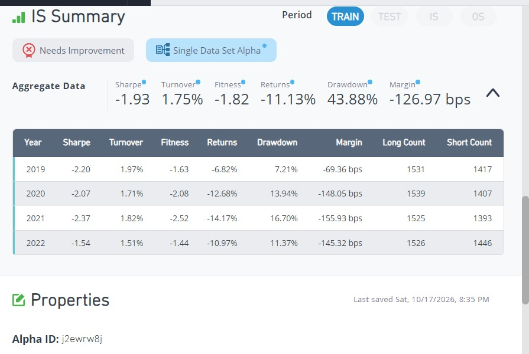
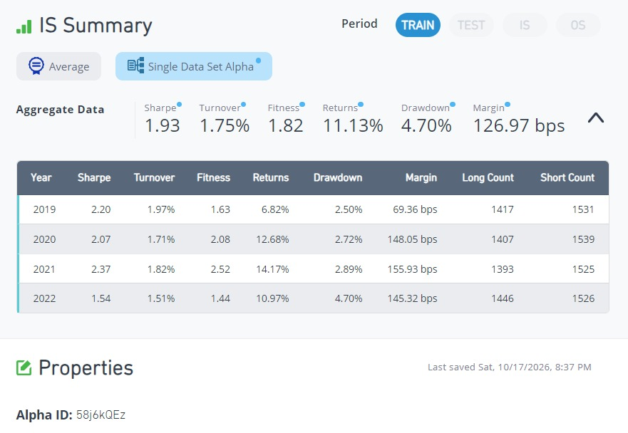
</details>

---

## 2. Value signals and why they swing with the market

| Expression | Idea | Sharpe | 2019 | 2020 | 2021 | 2022 |
|---|---|---|---|---|---|---|
| `rank(operating_income/cap)` | Earnings yield: profit relative to market value | 0.79 | -0.08 | **-2.73** | 1.97 | 1.67 |
| `rank(ebitda/enterprise_value)` | Inverse of EV/EBITDA (debt- and cash-adjusted) | 0.45 | -1.13 | -1.53 | 1.45 | 1.56 |

Both are classic "buy cheap companies" signals, and both broke down in 2019–2020, when growth stocks led the market and cheap stocks crashed during COVID. They recovered in 2021–2022 when value came back.
Ranking companies *against each other* by cheapness means always holding the same group of value stocks, so the alpha rides the value-vs-growth cycle.

`ebitda` is missing for about a third of the universe (banks, for example), so the second alpha traded only ~2,000 stocks.

<details>
<summary>Screenshots</summary>

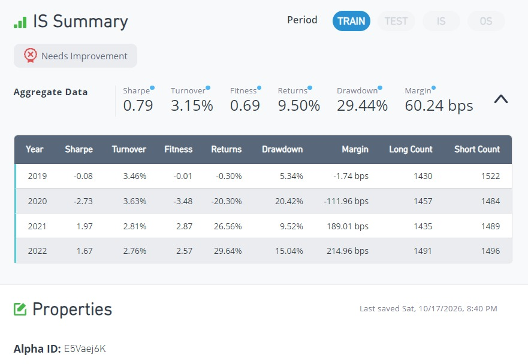
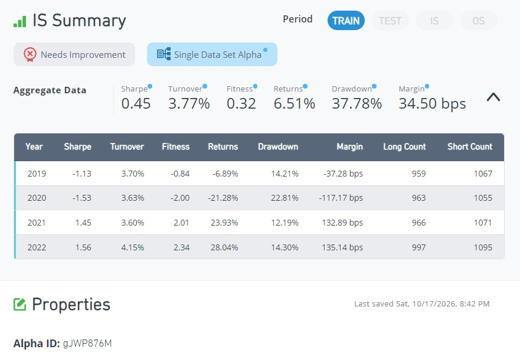
</details>

---

## 3. Time-series vs cross-sectional: Sharpe 0.79 → 1.54

The tutorial's analogy: a student who scores 80 can be compared with their own past scores (time-series) or with classmates' scores (cross-sectional).

| Type | Operators | Question it asks |
|---|---|---|
| Cross-sectional | `rank`, `zscore`, `winsorize` | Is this company cheap *compared with other companies today*? |
| Time-series | `ts_rank`, `ts_zscore`, `ts_mean` | Is this company cheap *compared with its own past*? |

I applied `ts_rank` to the same operating earnings yield (OEY = operating_income / cap):

| Expression | Sharpe | Turnover | Fitness | Drawdown | 2020 Sharpe |
|---|---|---|---|---|---|
| `rank(operating_income/cap)` | 0.79 | 3.15% | 0.69 | 29.44% | -2.73 |
| `ts_rank(operating_income/cap, 250)` | **1.54** | 8.16% | **1.27** | **7.01%** | **+0.62** |
| `ts_rank(operating_income/cap, 126)` | 1.51 | 10.28% | 1.13 | 6.05% | +1.11 |

Comparing each company with its own last year removes the "always long value stocks" tilt, so the 2020 crash disappeared. A one-year window kept turnover lower than a six-month one at the same Sharpe.

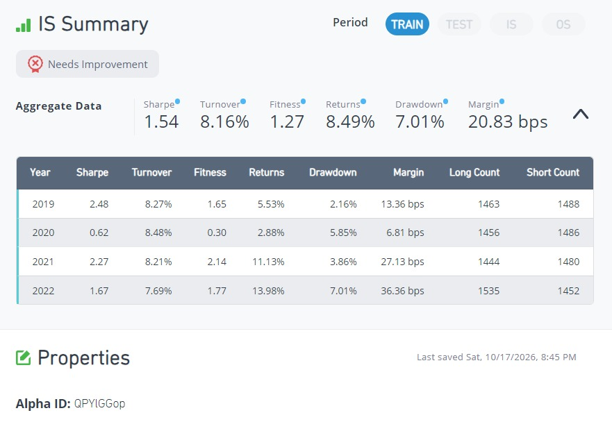

---

## 4. Does it survive in large caps? Universe test

Smaller universes keep only large, liquid stocks, where information is priced in faster, so signals usually get weaker. BRAIN's **sub-universe test** checks exactly this.

| Universe | Sharpe | Turnover | Fitness | Returns | Stocks held |
|---|---|---|---|---|---|
| TOP3000 | 1.54 | 8.16% | 1.27 | 8.49% | ~2,950 |
| TOP1000 | 1.75 | 8.79% | 1.59 | 10.26% | ~940 |
| TOP500 | 1.60 | 8.98% | 1.50 | 10.99% | ~440 |
| TOP200 | **1.79** | 9.43% | **2.07** | 16.78% | ~160 |

The opposite of what I expected: the signal held up, and was even stronger, in the largest 200 stocks. Large caps also react when their earnings yield improves against their own history.

<details>
<summary>Screenshots</summary>

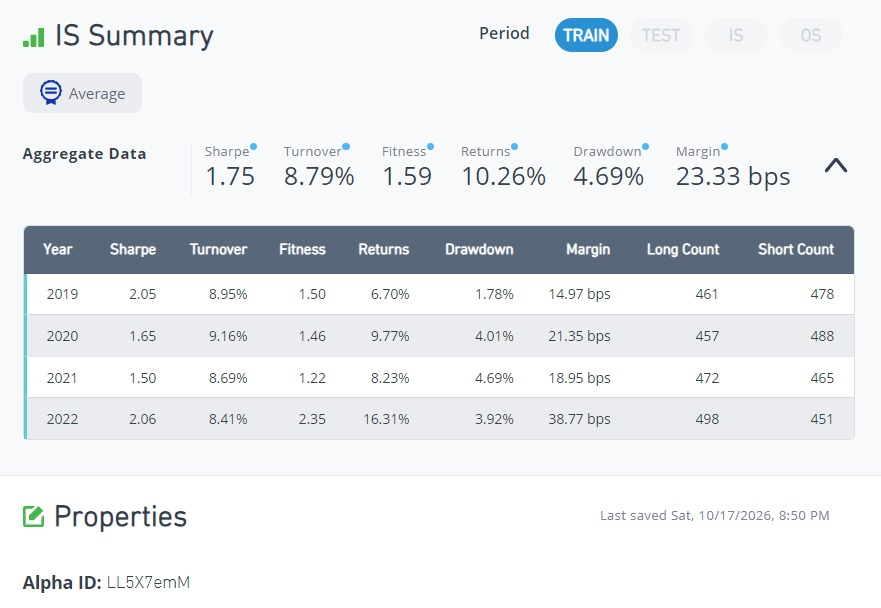
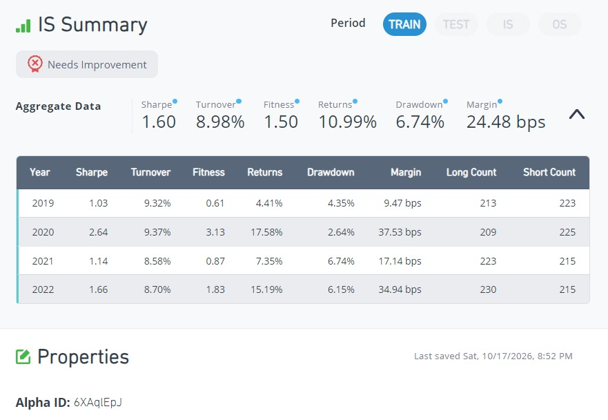
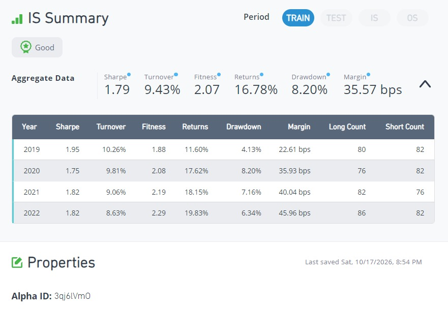
</details>

### Submitted: OEY time-series rank in TOP200 ✓

| Item | Detail |
|---|---|
| Expression | The tutorial's OEY `ts_rank` alpha above (250-day window) |
| Settings | **TOP200** · Subindustry · Decay 4 · Test period 0 |
| Result (2019–2023) | **Sharpe 1.64 · Fitness 1.76 · Turnover 9.43%** · Returns 14.39% · Drawdown 8.20% |
| Checks | 7 passed, self-correlation with my week 1 alpha 0.11 |

Setting test period to 0 shows the full in-sample period that the submission check actually uses (a week 1 lesson). 2023 was weaker (Sharpe 1.02), pulling the full-period Sharpe from 1.79 to 1.64, but still well above the 1.25 cutoff.

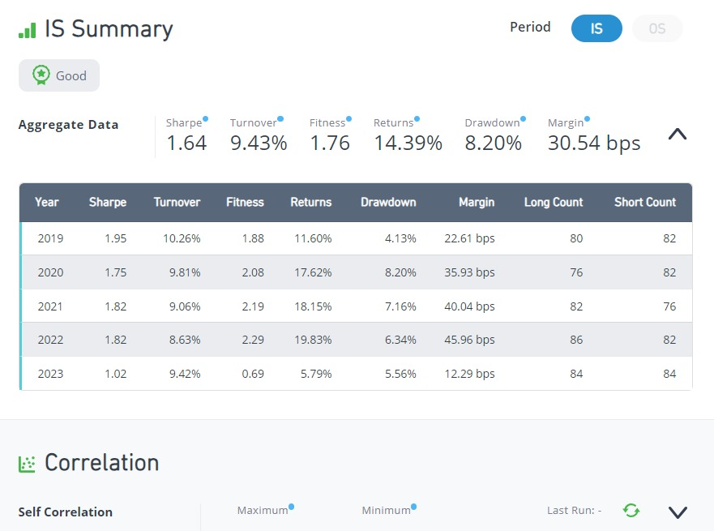
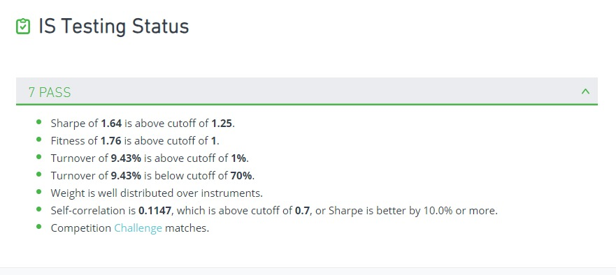
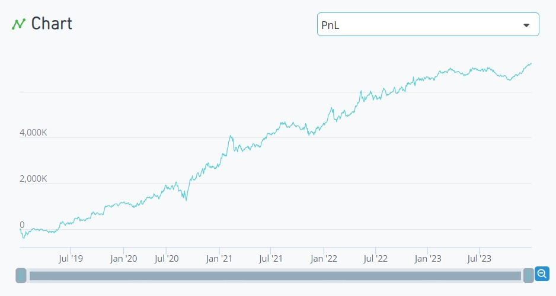

---

## 5. Option alphas: what option traders expect

**Idea:** option traders are usually better informed than stock traders. Implied volatility (IV) reflects option prices, so if call options are priced richer than puts (call IV > put IV), traders expect the stock to rise.

| Expression | Maturity | Sharpe | Turnover | Fitness |
|---|---|---|---|---|
| `rank(implied_volatility_call_120 - implied_volatility_put_120)` | 120 days | **1.91** | 44.22% | 0.81 |
| same with 30-day options (assigned to a variable `iv_difference`) | 30 days | 1.81 | 59.88% | 0.61 |

The signal was strong and positive every year, but IV changes daily, so turnover was in price–volume territory and fitness fell below 1. Short-dated IV is noisier and only added trading.

<details>
<summary>Screenshots</summary>

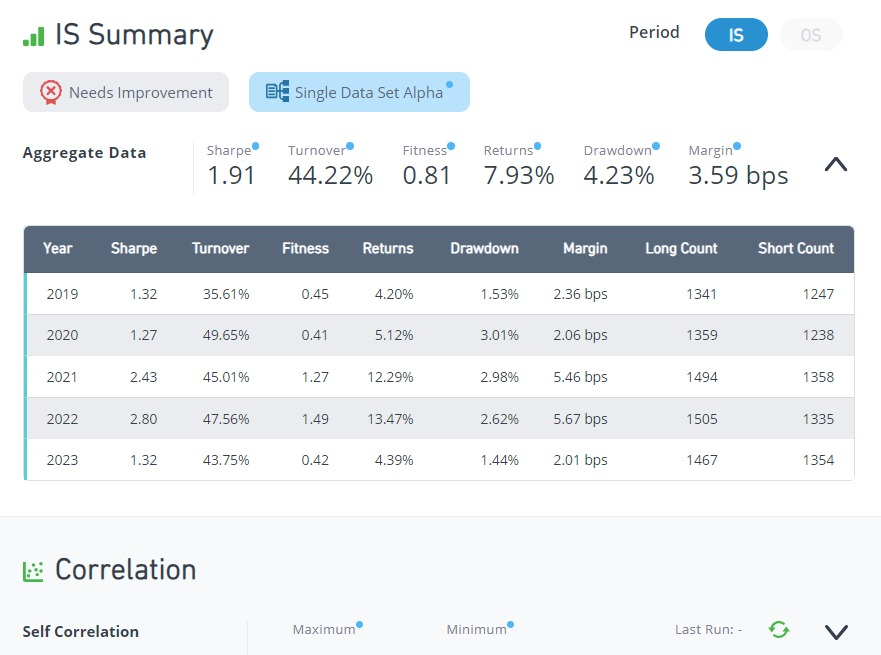
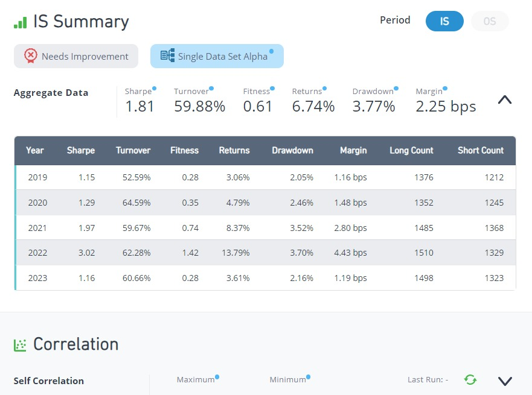
</details>

---

## 6. Group neutralization with custom buckets

Small and volatile stocks naturally have larger IV gaps. To compare like with like, I grouped stocks into deciles with `bucket` and neutralized within each group.

```
iv_difference = implied_volatility_call_120 - implied_volatility_put_120;
vol_group     = bucket(rank(historical_volatility_120), range="0.1,1,0.1");
group_neutralize(iv_difference, vol_group)
```

| Grouping | Sharpe | Fitness | Returns |
|---|---|---|---|
| None (section 5) | 1.91 | 0.81 | 7.93% |
| Market-cap deciles | 2.18 | 1.50 | 20.92% |
| Historical-volatility deciles | 2.15 | 1.51 | 21.90% |

Neutralization nearly doubled fitness. But it still **failed two submission checks**:

- **Weight concentration 12.66%** (limit 10%) on a single day, 2022-01-25
- **Sub-universe Sharpe 0.5** (needs 0.94): the signal lives mostly in small caps

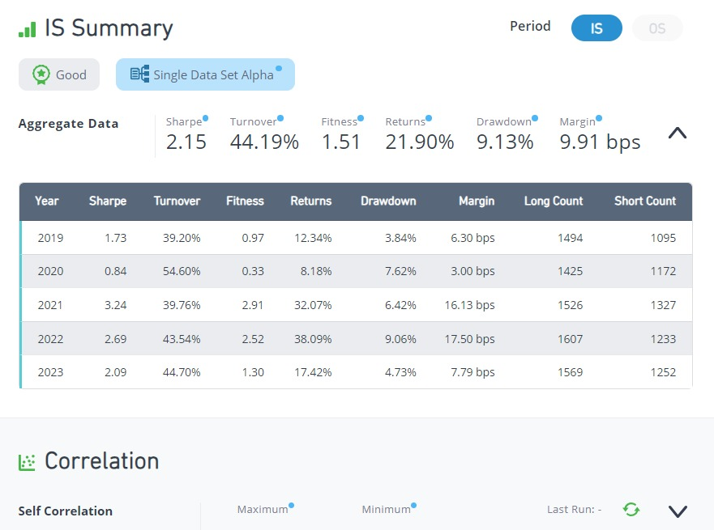
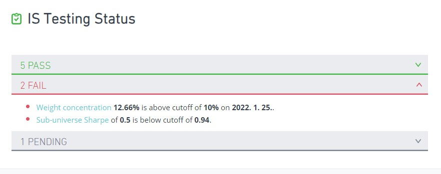

---

## 7. Getting the option alpha to pass — Sharpe 2.49 ✓

| Try | Change | Sharpe | Fitness | Failed checks | What I learned |
|---|---|---|---|---|---|
| 1 | Wrap the IV gap in `rank` | 2.05 | 0.86 | 3 | Concentration was **not** caused by outliers. Ranking erased useful magnitude |
| 2 | `ts_backfill(·, 20)` to fill gaps | 1.30 | 0.92 | 3 | Option data has long gaps in 2022–23; backfilling held stale values (2023 Sharpe −0.51) |
| 3 | Blend 50:50 with the OEY time-series signal | 2.12 | 1.16 | 1 | The fundamental signal, strong in large caps, **fixed the sub-universe test** and cut turnover to 31% |
| 4 | Turn on NaN handling | 2.12 | 1.16 | 1 | Identical result; the setting did not help |
| 5 | Replace `+` with `add(x, y, filter=true)` | **2.49** | **1.69** | **0** | `+` returns NaN if either side is NaN, so on days with no option data almost every stock dropped out. `filter=true` treats NaN as 0 |

### Submitted: option + fundamental blend ✓

| Item | Detail |
|---|---|
| Idea | 50% call–put IV gap (neutralized within volatility deciles) + 50% OEY time-series rank, combined NaN-safely |
| Operators | `rank`, `bucket`, `group_neutralize`, `ts_rank`, `add` |
| Data fields | `implied_volatility_call_120`, `implied_volatility_put_120`, `historical_volatility_120`, `operating_income`, `cap` |
| Settings | TOP3000 · Subindustry · Decay 4 · NaN handling On · Test period 0 |
| Result (2019–2023) | **Sharpe 2.49 · Fitness 1.69 · Turnover 24.44%** · Returns 11.20% · Drawdown 4.41% |
| Checks | 8 passed. Sub-universe Sharpe 1.35, self-correlation 0.26 |

> Since this alpha is my own submitted combination, I don't publish the exact expression.

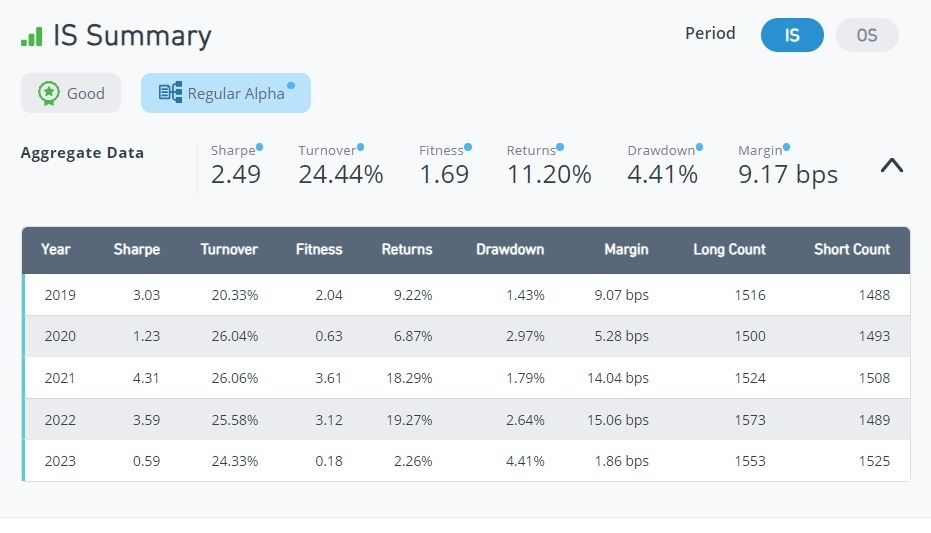
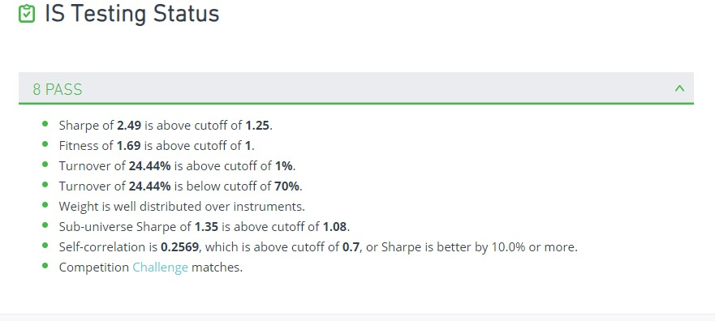
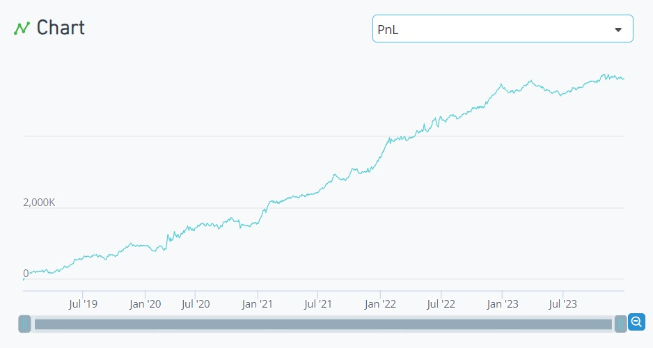

Both submitted alphas flattened in 2023 (Sharpe 1.02 and 0.59). Both use the earnings-yield time-series signal, which may have weakened that year.

---

## What I learned this week

1. **Fundamental data barely trades.** Turnover was 2–10%, compared with 30–130% for price–volume alphas.
2. **Compare with the company's own past.** `ts_rank` beat `rank` on the same earnings yield (Sharpe 0.79 → 1.54) and removed the value-cycle crash.
3. **A wrong hypothesis can still be a good alpha.** If a signal is consistently negative, flip it, then ask why.
4. **Read the failed check before tuning.** The concentration failure came from missing data on one day, not from outliers, so the fix was `add(..., filter=true)`, not `rank`.
5. **Blending signals with different strengths works again.** As in week 1, the fundamental leg covered the option signal's weak spot (large caps).

## Next week

- Explore analyst and sentiment data fields
- Try universes other than TOP3000 for lower correlation between my alphas
- Investigate why both submitted alphas weakened in 2023

## All experiments

<details>
<summary>Show all 19 runs</summary>

| # | Expression | Universe | Sharpe | Turnover | Fitness | Note |
|---|---|---|---|---|---|---|
| 1 | `rank(equity/assets)` | TOP3000 | -1.93 | 1.75% | -1.82 | |
| 2 | `rank(-equity/assets)` | TOP3000 | 1.93 | 1.75% | 1.82 | |
| 3 | `rank(operating_income/cap)` | TOP3000 | 0.79 | 3.15% | 0.69 | |
| 4 | `rank(ebitda/enterprise_value)` | TOP3000 | 0.45 | 3.77% | 0.32 | |
| 5 | `ts_rank(operating_income/cap, 250)` | TOP3000 | 1.54 | 8.16% | 1.27 | |
| 6 | `ts_rank(operating_income/cap, 126)` | TOP3000 | 1.51 | 10.28% | 1.13 | |
| 7 | #5 | TOP1000 | 1.75 | 8.79% | 1.59 | |
| 8 | #5 | TOP500 | 1.60 | 8.98% | 1.50 | |
| 9 | #5 | TOP200 | 1.79 | 9.43% | 2.07 | |
| 10 | #5, test period 0 | TOP200 | 1.64 | 9.43% | 1.76 | Submitted |
| 11 | `rank(iv_call_120 - iv_put_120)` | TOP3000 | 1.91 | 44.22% | 0.81 | Test period 0 from here |
| 12 | same, 30-day maturity | TOP3000 | 1.81 | 59.88% | 0.61 | |
| 13 | IV gap, market-cap bucket neutralized | TOP3000 | 2.18 | 44.36% | 1.50 | 2 checks failed |
| 14 | IV gap, volatility bucket neutralized | TOP3000 | 2.15 | 44.19% | 1.51 | 2 checks failed |
| 15 | #14 with `rank` | TOP3000 | 2.05 | 44.78% | 0.86 | 3 checks failed |
| 16 | #14 with `ts_backfill` | TOP3000 | 1.30 | 27.43% | 0.92 | 3 checks failed |
| 17 | #14 blended with OEY `ts_rank` | TOP3000 | 2.12 | 30.72% | 1.16 | 1 check failed |
| 18 | #17, NaN handling On | TOP3000 | 2.12 | 30.72% | 1.16 | 1 check failed |
| 19 | #18 with `add(filter=true)` | TOP3000 | 2.49 | 24.44% | 1.69 | Submitted |

</details>
