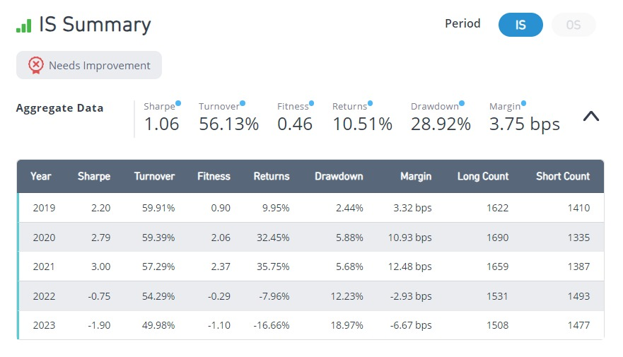
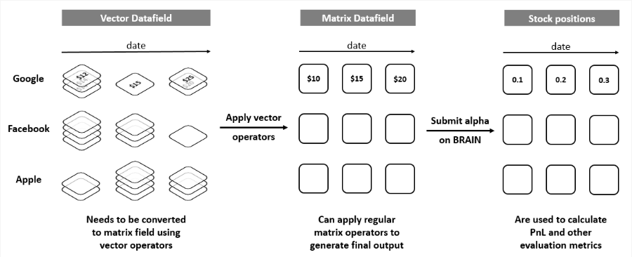
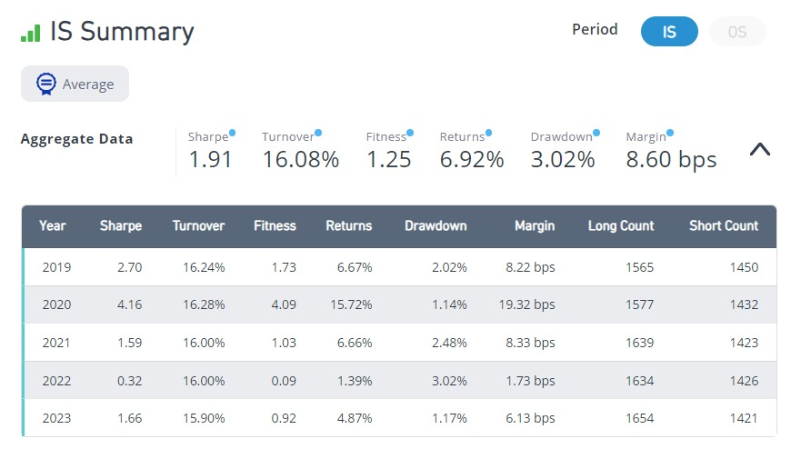
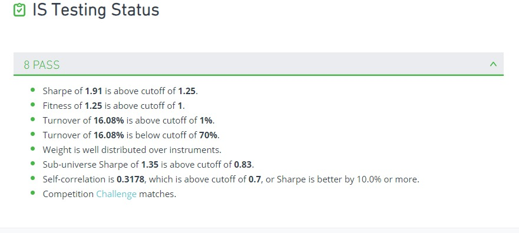
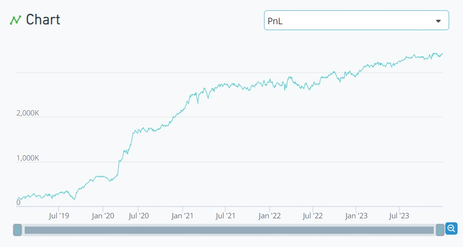
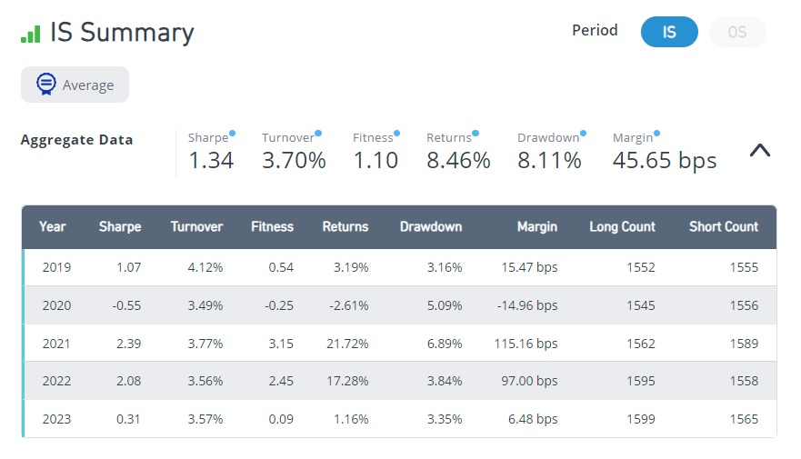
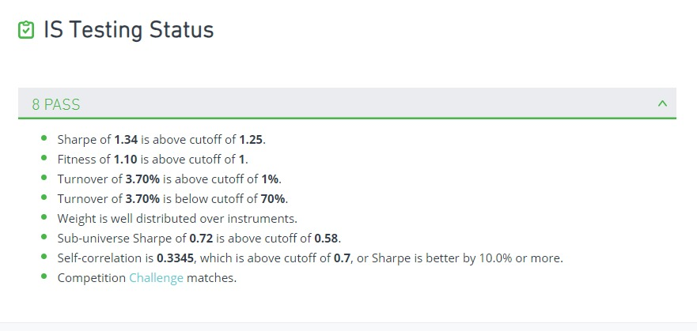
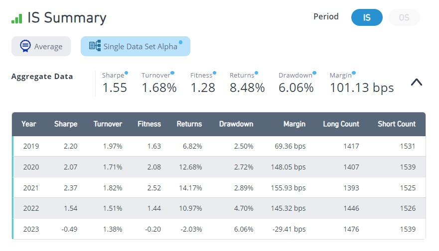
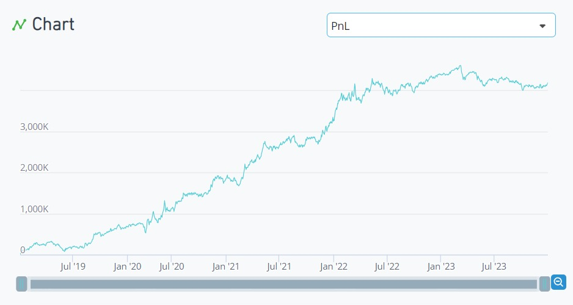
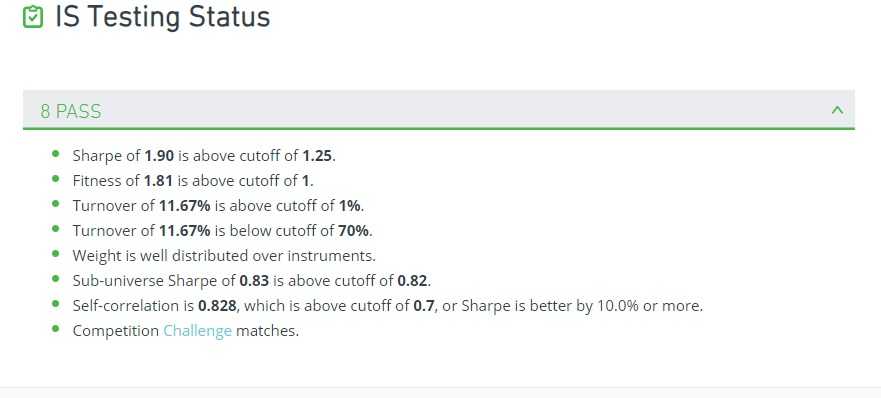

# Week 3: Sentiment & News Alphas, and the Road to Gold

- Dates: 2026-10-20 → 2026-10-24 (midterm week)
- Scope: BRAIN Tutorial Chapter 5 (complete) and Chapter 6 (in progress: reach 10,000 Challenge points)
- Simulations: 25, 3 submitted this week (6 in total)
- Common settings: USA · D1 · TOP3000 · Truncation 0.08 · NaN handling On · Test period 0 (full in-sample period)

## Summary

Chapter 5 introduced **social-media sentiment** and **news** data. News is stored as *vector* data (several items per stock per day), so it has to be collapsed with `vec_avg` before normal operators can use it.
Chapter 6 has a single task: keep submitting until the Challenge score reaches 10,000 (Gold). That turned out to be the hard part. **Variations of an alpha I had already submitted were blocked by the self-correlation check, even when they performed better.** Every new submission needed a genuinely new idea. New ideas were usually weak on their own, but blending two or three of them with different characteristics got them over the bar.

The score went from 3,876 to 7,690, with one more submission pending and the next candidate ready.

## Roadmap

```
Chapter 5 – Sentiment & News
  social buzz vs volume (ts_regression)   Sharpe ±1.06, direction flips in 2022
  news "long-favoured" → momentum, else 5-day reversal
                                          Sharpe 1.91  --> SUBMITTED (Decay 8)
Chapter 6 – Expand ideas, reach Gold
  universe / neutralization / signed_power / trade_when on the news alpha
                                          up to Sharpe 2.03, but self-correlation 0.94 → blocked
  analyst-revision (reversed) + financial health (FFO / debt)
                                          0.90 + 0.67 → 1.34  --> SUBMITTED
  leverage alpha from week 2, re-checked on the full period
                                          Sharpe 1.55  --> SUBMITTED
  option IV gap + liability fair value + leverage
                                          Sharpe 1.90, Fitness 1.81 --> next candidate
```

---

## 1. Sentiment: social buzz versus trading volume

**Idea:** if a stock is discussed online far more than its trading volume would suggest, attention may be overheated.

`ts_regression(y, x, d)` fits a line of `y` on `x` over the last `d` days and returns the residual, here "how much more buzz than volume explains".

| Expression | Sharpe | 2019 | 2020 | 2021 | 2022 | 2023 |
|---|---|---|---|---|---|---|
| `ts_regression(scl12_buzz, volume, 250)` | -1.06 | -2.20 | -2.79 | -3.00 | +0.75 | +1.90 |
| `-ts_regression(scl12_buzz, volume, 250)` | 1.06 | **+2.20** | **+2.79** | **+3.00** | -0.75 | -1.90 |

Flipped, the signal was very strong through 2021 (excess attention → price falls) and then **reversed direction from 2022**. The aggregate Sharpe of 1.06 hides a regime change; only the yearly table reveals it. I did not use it further.



## 2. News: vector data and a conditional alpha

News data covers earnings reports, analyst calls, product approvals and legal events, mostly published before or after the main session. Because one stock can have several news items per day, the fields are **vectors**. `vec_avg` turns each day's items into a single number.



`nws12_afterhsz_sl` tells whether going long or short was more profitable after each news release.

**Idea:** stocks whose recent news favoured longs show momentum; the rest tend to revert. One conditional expression combines both:

- 60-day average of `vec_avg(nws12_afterhsz_sl)`, ranked
- top half → constant long (momentum); bottom half → 5-day price reversal

| Version | Sharpe | Turnover | Fitness | Margin |
|---|---|---|---|---|
| Decay 4 (tutorial step) | 1.95 | 22.73% | 1.12 | 6.58 bps |
| **Decay 8** | 1.91 | **16.08%** | **1.25** | **8.60 bps** |

Raising Decay cut turnover by a third with almost no loss of Sharpe, the same lesson as week 1.

### Submitted: news momentum / reversal ✓

| Item | Detail |
|---|---|
| Operators | `vec_avg`, `ts_mean`, `rank`, `ts_delta`, conditional `? :` |
| Data fields | `nws12_afterhsz_sl`, `close` |
| Settings | TOP3000 · Subindustry · Decay 8 |
| Result (2019–2023) | **Sharpe 1.91 · Fitness 1.25 · Turnover 16.08%** · Returns 6.92% · Drawdown 3.02% |
| Checks | 8 passed. Sub-universe 1.35, self-correlation 0.32 |

> For submitted alphas I share the idea, operators and data fields, but not the exact expression.





---

## 3. Chapter 6: expanding an idea, and why it was not enough

The tutorial lists four ways to get more alphas from one idea. I applied each to the news alpha:

| Method | Change | Sharpe | Fitness | Outcome |
|---|---|---|---|---|
| (baseline) | submitted alpha | 1.91 | 1.25 | submitted |
| Universe | TOP1000 | 1.44 | 0.83 | fails — signal lives in smaller stocks |
| Neutralization | Industry | 1.73 | 1.17 | passes thresholds |
| Position distribution | reversal leg → `signed_power(·, 2)` | **2.03** | **1.35** | best |
| Synergy | `trade_when(volume > adv20, ·, -1)` | 1.54 | 0.90 | fails |
| Size neutralization | `group_neutralize` by market-cap deciles (`regression_neut` is not available at my level) | 1.94 | 1.25 | **self-correlation 0.94 → blocked** |

**The catch:** BRAIN rejects a new alpha whose correlation with one of my submitted alphas exceeds 0.7, unless its Sharpe is at least 10% higher. Every variation above was essentially the same alpha. Better metrics did not help.


## 4. Finding new ideas

When tuning stopped helping, I searched the web (analyst estimate revisions are an unused data category; a common recipe is signal → scale by volatility → neutralize). I also used BRAIN's built-in **Example** alphas. Note: loading an example also resets the simulation settings.

| # | Idea | Sharpe | Outcome |
|---|---|---|---|
| 12 | 20-day change in consensus EPS ÷ price | -0.13 | no signal |
| 13 | Analyst dispersion (std ÷ mean of estimates) | -0.12 | collapsed in 2020 |
| 14 | `-rank(ebit/capex)` (BRAIN example) | -0.20 | fails |
| 15 | Funds from operations ÷ long-term debt, 1-year time-series rank | 0.67 | weak but positive |
| 16→17 | Analyst-revision momentum score, then reversed | -0.90 → 0.90 | over-reaction to revisions reverts |
| 18 | 17 + 15, 50:50 | 1.32 | 8 checks passed |
| 19 | 18 with Industry neutralization | **1.34** | **submitted** |

### Submitted: analyst-revision reversal + financial health ✓

| Item | Detail |
|---|---|
| Idea | Fade stocks whose analyst estimates were revised up most (over-reaction) and buy companies whose cash flow relative to debt is improving versus their own past |
| Data fields | `composite_factor_score_derivative`, `fnd6_fopo`, `debt_lt` |
| Settings | TOP3000 · Industry · Decay 8 |
| Result | **Sharpe 1.34 · Fitness 1.10 · Turnover 3.70%** · Margin 45.65 bps |
| Checks | 8 passed. Self-correlation 0.33 |





### Submitted: leverage, revisited ✓

The week 2 alpha `rank(-equity/assets)` (more leveraged companies within a subindustry outperform) was never submitted. On the full 2019–2023 period it scored **Sharpe 1.55, Fitness 1.28, Turnover 1.7%** and passed all eight checks (self-correlation 0.66).




## 5. Next candidate: three signals blended

| # | Attempt | Sharpe | Outcome |
|---|---|---|---|
| 21 | Low-volatility anomaly | 0.13 | crashed in 2020 |
| 22 | Increase in fair value of liabilities → short (BRAIN example, shorter window) | 0.91 | only ~500 stocks covered |
| 23 | 22 + option call–put IV gap | 1.67 | sub-universe 0.47 fails |
| 24 | 23 tilted toward large caps (× `rank(cap)`) | 1.09 | fixes sub-universe, kills the signal |
| 25 | 23 + leverage signal (strong in large caps) | **1.90** | **8 checks passed, Fitness 1.81** |

#25 has a self-correlation of 0.83, but passes because its Sharpe is more than 10% above the correlated alpha. Its sub-universe Sharpe (0.83 vs a 0.82 cutoff) is right at the edge. It will be submitted next, since the daily point cap was already used.




---

## Submitted alphas so far

| Date | Week · chapter | Ingredients | Idea | Sharpe | Fitness |
|---|---|---|---|---|---|
| 10/11 | 1 · Ch2 | price + fundamentals | Short-term reversal + profitability | 2.46 | 1.91 |
| 10/17 | 2 · Ch3 | fundamentals + price | Earnings-yield time-series rank (TOP200) | 1.64 | 1.76 |
| 10/17 | 2 · Ch4 | options + fundamentals | Call–put IV gap + earnings yield | 2.49 | 1.69 |
| 10/20 | 3 · Ch5 | **news** + price | News-conditioned momentum / reversal | 1.91 | 1.25 |
| 10/21 | 3 · Ch6 | **analyst** + fundamentals | Revision reversal + financial health | 1.34 | 1.10 |
| 10/24 | 3 · Ch6 | fundamentals | Leverage | 1.55 | 1.28 |

## What I learned this week

1. **Vector data needs a `vec_` operator first.** Once collapsed, one conditional expression can switch between momentum and reversal.
2. **Read the yearly table, not just the total.** The sentiment signal flipped sign in 2022, and its total Sharpe hid that.
3. **A better alpha is not necessarily a submittable one.** Variations of a submitted idea hit self-correlation 0.94. The exception is a Sharpe at least 10% higher than the correlated alpha.
4. **New ideas start weak; blending makes them work.** Twice this week, two or three signals that each failed on their own (0.67–0.91) passed together (1.34, 1.90).
5. **Fix sub-universe failures with a large-cap-friendly signal, not a size tilt.** Multiplying by market cap fixed the check but destroyed the signal.

## Next week

- Submit the three-signal blend and reach Gold (10,000 points)
- Look for ingredients not yet used: volume patterns, other universes (TOP1000 / TOP500)

## All experiments

<details>
<summary>Show all 25 runs</summary>

| # | Idea | Neut. / Decay | Sharpe | Turnover | Fitness | Note |
|---|---|---|---|---|---|---|
| 1 | Buzz vs volume regression (250d) | Sub / 4 | -1.06 | 56% | -0.46 | |
| 2 | #1 reversed | Sub / 4 | 1.06 | 56% | 0.46 | flips in 2022 |
| 3 | News-conditioned momentum / reversal | Sub / 4 | 1.95 | 23% | 1.12 | 8 passed |
| 4 | #3, Decay 8 | Sub / 8 | 1.91 | 16% | 1.25 | submitted |
| 5 | #4 in TOP1000 | Sub / 8 | 1.44 | 17% | 0.83 | |
| 6 | #4, Industry | Ind / 8 | 1.73 | 15% | 1.17 | |
| 7 | #4 with `signed_power` reversal | Sub / 8 | 2.03 | 14% | 1.35 | |
| 8 | #7 with `trade_when` | Sub / 8 | 1.54 | 11% | 0.90 | |
| 9 | #7, market-cap group neutralized | Sub / 8 | 1.94 | 14% | 1.25 | self-corr 0.94 |
| 10 | #2 with 20-day window | Sub / 8 | 0.58 | 42% | 0.21 | |
| 11 | Implied ÷ historical volatility, reversed | Sub / 8 | -0.79 | 4% | -0.42 | |
| 12 | EPS estimate change ÷ price | Sub / 8 | -0.13 | 12% | -0.03 | |
| 13 | Analyst dispersion | Sub / 8 | -0.12 | 5% | -0.03 | |
| 14 | EBIT ÷ capex (example) | default | -0.20 | 1% | -0.09 | settings reset |
| 15 | FFO ÷ LT debt, time-series rank | Sub / 8 | 0.67 | 4% | 0.23 | |
| 16 | Analyst-revision score | Sub / 8 | -0.90 | 2% | -0.63 | |
| 17 | #16 reversed | Sub / 8 | 0.90 | 2% | 0.63 | |
| 18 | #17 + #15 | Sub / 8 | 1.32 | 4% | 1.01 | 8 passed |
| 19 | #18, Industry | Ind / 8 | 1.34 | 4% | 1.10 | submitted |
| 20 | Leverage (week 2 alpha) | Sub / 4 | 1.55 | 2% | 1.28 | submitted |
| 21 | Low volatility | Sub / 4 | 0.13 | 2% | 0.06 | |
| 22 | Liability fair value, reversed | Sub / 4 | 0.91 | 7% | 0.74 | |
| 23 | #22 + IV gap | Sub / 8 | 1.67 | 18% | 1.06 | sub-universe fails |
| 24 | #23 × rank(cap) | Sub / 8 | 1.09 | 14% | 0.62 | |
| 25 | #23 + leverage | Sub / 8 | 1.90 | 12% | 1.81 | next candidate |

</details>
