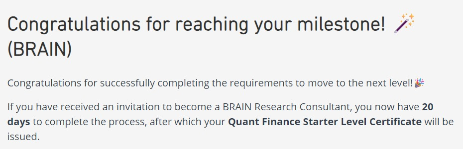
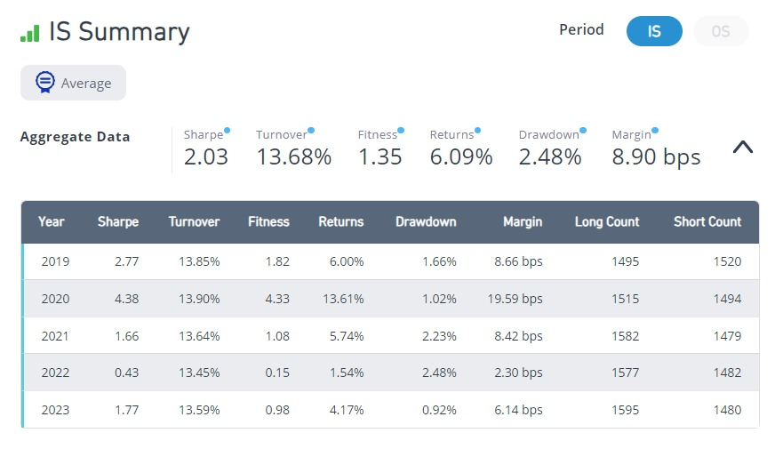
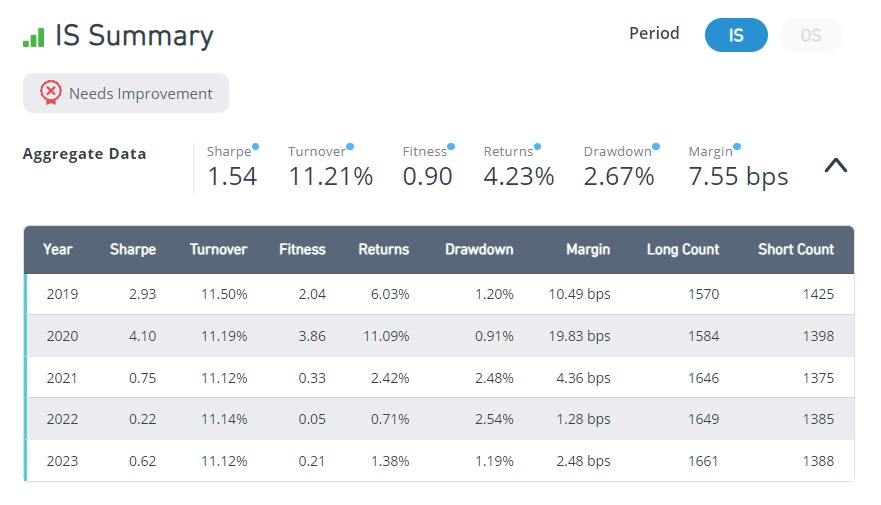
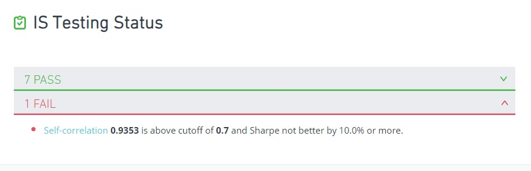
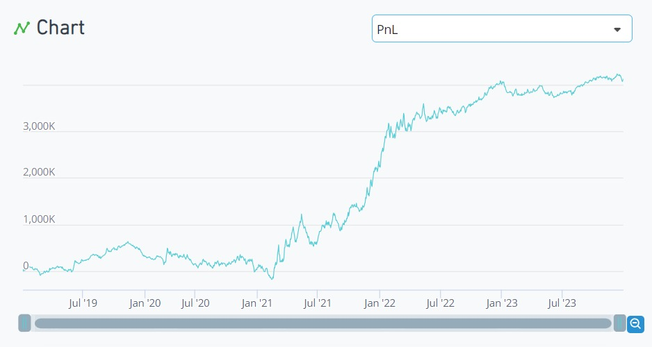
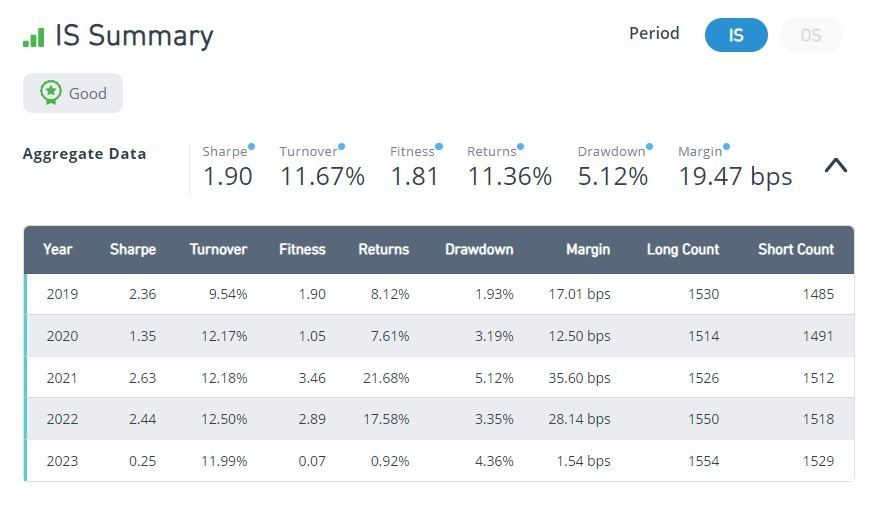
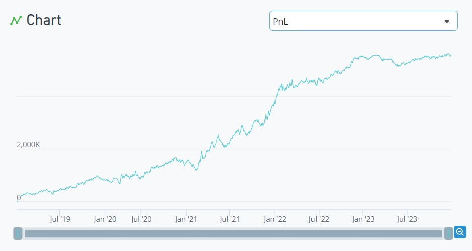

# Week 4: Expanding Ideas and Reaching Gold

- Dates: 2026-10-20 → 2026-10-28 (started early, during week 3)
- Scope: BRAIN Tutorial Chapter 6 — Completion: reach 10,000 Challenge points (Gold) ✓
- Simulations: 21, 3 submitted (7 in total)
- Common settings: USA · D1 · TOP3000 · Truncation 0.08 · NaN handling On · Test period 0 (full in-sample period)



## Summary

Chapter 6 has one task: keep submitting until the Challenge score reaches 10,000 (Gold). The daily cap is 2,000 points and one alpha earned about 1,900, so it meant one new alpha a day.

The hard part was not performance but **originality**. Variations of an alpha I had already submitted were blocked by the self-correlation check, even when they performed better. Every new submission needed a genuinely new idea. New ideas were usually weak on their own, but blending two or three signals with different characteristics got them over the bar.

Score: 3,876 → 7,690 → 9,587 → **Gold** (confirmed 10/28).

## Roadmap

```
Expand the week 3 news alpha (universe / neutralization / signed_power / trade_when)
    up to Sharpe 2.03, but self-correlation 0.94 → blocked
New data: analyst-revision (reversed) + financial health (FFO / debt)
    0.90 + 0.67 → 1.34                       --> SUBMITTED (10/21)
Leverage alpha from week 2, re-checked on the full period
    Sharpe 1.55                              --> SUBMITTED (10/24)
Option IV gap + liability fair value + leverage
    Sharpe 1.90, Fitness 1.81                --> SUBMITTED (10/25) → Gold
```

---

## 1. Four ways to expand an idea

The tutorial lists four ways to get more alphas from one idea: change the universe, change the neutralization, change how positions are distributed (`rank`, `signed_power`, `log`), and combine related alphas (for example `trade_when(A1 > x, A2, A1 <= x)`). It also warns against over-tuning in-sample, and against adding unrelated alphas together; diversification should be judged by whether one alpha holds up while another is in drawdown.

I applied each method to my week 3 news alpha:

| Method | Change | Sharpe | Fitness | Outcome |
|---|---|---|---|---|
| (baseline) | week 3 submission | 1.91 | 1.25 | already submitted |
| Universe | TOP1000 | 1.44 | 0.83 | fails — signal lives in smaller stocks |
| Neutralization | Industry | 1.73 | 1.17 | passes thresholds |
| Position distribution | reversal leg → `signed_power(·, 2)` | **2.03** | **1.35** | best |
| Synergy | `trade_when(volume > adv20, ·, -1)` | 1.54 | 0.90 | fails — updates too slowly |
| Size neutralization | `group_neutralize` by market-cap deciles (`regression_neut` is not available at my level) | 1.94 | 1.25 | **self-correlation 0.94 → blocked** |




## 2. The self-correlation wall

BRAIN rejects a new alpha whose correlation with one of my submitted alphas exceeds 0.7, **unless its Sharpe is at least 10% higher**. Every variation above was essentially the same alpha, so better metrics did not help.



## 3. Finding new ideas

When tuning stopped helping, I searched the web (analyst estimate revisions are an unused data category; a common recipe is signal → scale by volatility → neutralize). I also used BRAIN's built-in **Example** alphas. Note: loading an example also resets the simulation settings.

| # | Idea | Sharpe | Outcome |
|---|---|---|---|
| 12 | 20-day change in consensus EPS ÷ price | -0.13 | no signal |
| 13 | Analyst dispersion (std ÷ mean of estimates) | -0.12 | collapsed in 2020 |
| 14 | `-rank(ebit/capex)` (BRAIN example) | -0.20 | fails |
| 15 | Funds from operations ÷ long-term debt, 1-year time-series rank | 0.67 | weak but positive |
| 16→17 | Analyst-revision momentum score, then reversed | -0.90 → 0.90 | over-reaction to revisions reverts |
| 18 | 17 + 15, 50:50 | 1.32 | 8 checks passed |
| 19 | 18 with Industry neutralization | **1.34** | **submitted** |

### Submitted: analyst-revision reversal + financial health ✓

| Item | Detail |
|---|---|
| Idea | Fade stocks whose analyst estimates were revised up most (over-reaction) and buy companies whose cash flow relative to debt is improving versus their own past |
| Data fields | `composite_factor_score_derivative`, `fnd6_fopo`, `debt_lt` |
| Settings | TOP3000 · Industry · Decay 8 |
| Result | **Sharpe 1.34 · Fitness 1.10 · Turnover 3.70%** · Margin 45.65 bps |
| Checks | 8 passed. Self-correlation 0.33 |

> For submitted alphas I share the idea, operators and data fields, but not the exact expression.




### Submitted: leverage, revisited ✓

The week 2 alpha `rank(-equity/assets)` (more leveraged companies within a subindustry outperform) was never submitted. On the full 2019–2023 period it scored **Sharpe 1.55, Fitness 1.28, Turnover 1.7%** and passed all eight checks (self-correlation 0.66). Alphas built earlier but never submitted are worth re-checking.


## 4. Three signals blended → Gold ✓

| # | Attempt | Sharpe | Outcome |
|---|---|---|---|
| 21 | Low-volatility anomaly | 0.13 | crashed in 2020 |
| 22 | Increase in fair value of liabilities → short (BRAIN example, 66-day window) | 0.91 | only ~500 stocks covered |
| 23 | 22 + option call–put IV gap | 1.67 | sub-universe 0.47 fails |
| 24 | 23 tilted toward large caps (× `rank(cap)`) | 1.09 | fixes sub-universe, kills the signal |
| 25 | 23 + leverage signal (strong in large caps) | **1.90** | **8 checks passed → submitted** |

| Item | Detail |
|---|---|
| Idea | Equal-weight blend of the option traders' bullishness (call–put IV gap), falling liability fair value, and leverage |
| Chapter 6 concepts | Alpha synergy (combining signals), `rank` for position distribution, NaN-safe `add(…, filter=true)` |
| Settings | TOP3000 · Subindustry · Decay 8 |
| Result | **Sharpe 1.90 · Fitness 1.81 · Turnover 11.67%** · Returns 11.36% · Drawdown 5.12% |
| Checks | 8 passed. Self-correlation 0.83 passes because its Sharpe is >10% above the correlated alpha; sub-universe 0.83 vs a 0.82 cutoff |





## 5. After Gold

Reaching Gold unlocks the Research Consultant application. The Quantitative Finance Starter Level Certificate is issued once two onboarding steps in WorldQuant's Workday portal are completed within 20 days: submitting details for a background check, then signing the consulting agreement. Consultants get performance-based compensation, 100,000+ data fields across 8+ regions, the Python API and other advanced features.

---

## Submitted alphas so far

| Date | Week · chapter | Ingredients | Idea | Sharpe | Fitness |
|---|---|---|---|---|---|
| 10/11 | 1 · Ch2 | price + fundamentals | Short-term reversal + profitability | 2.46 | 1.91 |
| 10/17 | 2 · Ch3 | fundamentals + price | Earnings-yield time-series rank (TOP200) | 1.64 | 1.76 |
| 10/17 | 2 · Ch4 | options + fundamentals | Call–put IV gap + earnings yield | 2.49 | 1.69 |
| 10/20 | 3 · Ch5 | news + price | News-conditioned momentum / reversal | 1.91 | 1.25 |
| 10/21 | 4 · Ch6 | **analyst** + fundamentals | Revision reversal + financial health | 1.34 | 1.10 |
| 10/24 | 4 · Ch6 | fundamentals | Leverage | 1.55 | 1.28 |
| 10/25 | 4 · Ch6 | options + fundamentals | IV gap + liability fair value + leverage | 1.90 | 1.81 |

## What I learned this week

1. **A better alpha is not necessarily a submittable one.** Variations of a submitted idea hit self-correlation 0.94. The exception is a Sharpe at least 10% higher than the correlated alpha.
2. **New ideas start weak; blending makes them work.** Twice this week, signals that each failed on their own (0.67–0.91) passed together (1.34, 1.90).
3. **Fix sub-universe failures with a large-cap-friendly signal, not a size tilt.** Multiplying by market cap fixed the check but destroyed the signal.
4. **Re-check old alphas on the full period.** An unsubmitted week 2 alpha passed all checks.
5. **Pace submissions.** Points arrive the day after submission and are capped at 2,000 per day, so one strong alpha per day is the plan.

## Next

- Complete the Research Consultant onboarding to receive the certificate
- Use the unlocked data and regions to try ingredients not yet used (volume patterns, other universes)

## All experiments

<details>
<summary>Show all 21 runs (numbering continues from week 3)</summary>

| # | Idea | Neut. / Decay | Sharpe | Turnover | Fitness | Note |
|---|---|---|---|---|---|---|
| 5 | News alpha in TOP1000 | Sub / 8 | 1.44 | 17% | 0.83 | |
| 6 | News alpha, Industry | Ind / 8 | 1.73 | 15% | 1.17 | |
| 7 | News alpha with `signed_power` reversal | Sub / 8 | 2.03 | 14% | 1.35 | |
| 8 | #7 with `trade_when` | Sub / 8 | 1.54 | 11% | 0.90 | |
| 9 | #7, market-cap group neutralized | Sub / 8 | 1.94 | 14% | 1.25 | self-corr 0.94 |
| 10 | Buzz regression, 20-day window | Sub / 8 | 0.58 | 42% | 0.21 | |
| 11 | Implied ÷ historical volatility, reversed | Sub / 8 | -0.79 | 4% | -0.42 | |
| 12 | EPS estimate change ÷ price | Sub / 8 | -0.13 | 12% | -0.03 | |
| 13 | Analyst dispersion | Sub / 8 | -0.12 | 5% | -0.03 | |
| 14 | EBIT ÷ capex (example) | default | -0.20 | 1% | -0.09 | settings reset |
| 15 | FFO ÷ LT debt, time-series rank | Sub / 8 | 0.67 | 4% | 0.23 | |
| 16 | Analyst-revision score | Sub / 8 | -0.90 | 2% | -0.63 | |
| 17 | #16 reversed | Sub / 8 | 0.90 | 2% | 0.63 | |
| 18 | #17 + #15 | Sub / 8 | 1.32 | 4% | 1.01 | 8 passed |
| 19 | #18, Industry | Ind / 8 | 1.34 | 4% | 1.10 | submitted |
| 20 | Leverage (week 2 alpha) | Sub / 4 | 1.55 | 2% | 1.28 | submitted |
| 21 | Low volatility | Sub / 4 | 0.13 | 2% | 0.06 | |
| 22 | Liability fair value, reversed | Sub / 4 | 0.91 | 7% | 0.74 | |
| 23 | #22 + IV gap | Sub / 8 | 1.67 | 18% | 1.06 | sub-universe fails |
| 24 | #23 × rank(cap) | Sub / 8 | 1.09 | 14% | 0.62 | |
| 25 | #23 + leverage | Sub / 8 | 1.90 | 12% | 1.81 | submitted → Gold |

</details>
